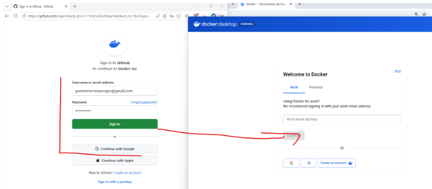
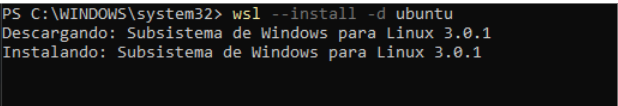
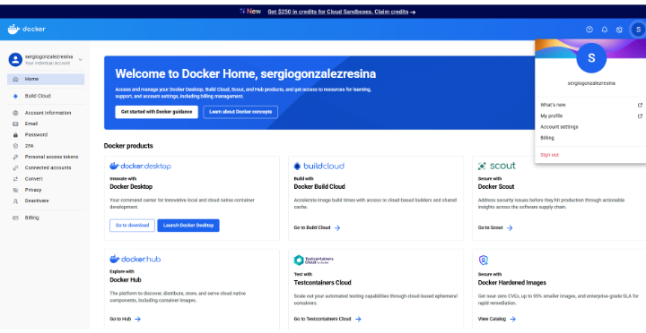
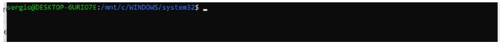
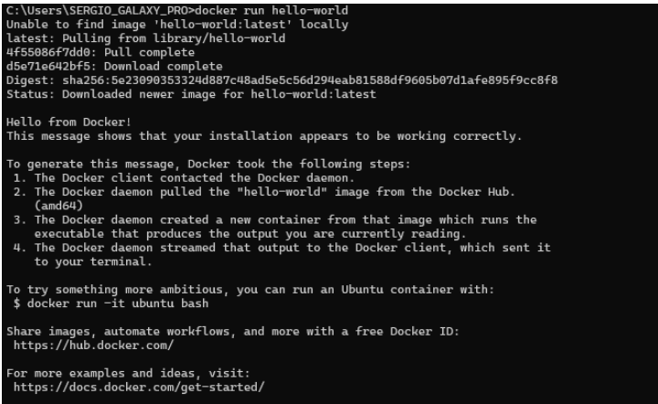

# Configuración de Docker con Ubuntu (WSL)

## 1. Iniciar sesión en Docker

Abre Docker Desktop e inicia sesión con tu cuenta.


> **Comentario:** Comprueba que Docker Desktop se ha abierto correctamente antes de continuar.

## 2. Activar la integración con Ubuntu

1. En Docker Desktop, entra en **Settings**.
2. Accede a **Resources → WSL Integration**.
3. Busca la distribución **Ubuntu** y activa su interruptor.
4. Pulsa **Apply & Restart** si aparece esa opción.


> **Comentario:** Esta opción permite utilizar Docker desde la terminal de Ubuntu a través de WSL.

## 3. Comprobar que funciona

Abre la terminal de Ubuntu y ejecuta:

```bash
docker --version
```


Después, ejecuta:

```bash
docker run hello-world
```


> **Comentario:** El primer comando muestra la versión de Docker. El segundo ejecuta una imagen de prueba para comprobar que Docker puede comunicarse con su motor.

---

## 0. Imágenes del proceso 
Imagenes

### INCIAR SESION





### INSTILAR UBUNTU





### MOSTRAR QUE EL DOCKER DESKTOP ESTA DESCARGADO





### OSTRAR QUE ESTAS DENTRO DE UBUNTU





### IMPRIMIR EL HELLO WORDL




> **Comentario:** Las imágenes de todo el proceso documentado hasta llegar a imprimir hello wordl n docker.

---

